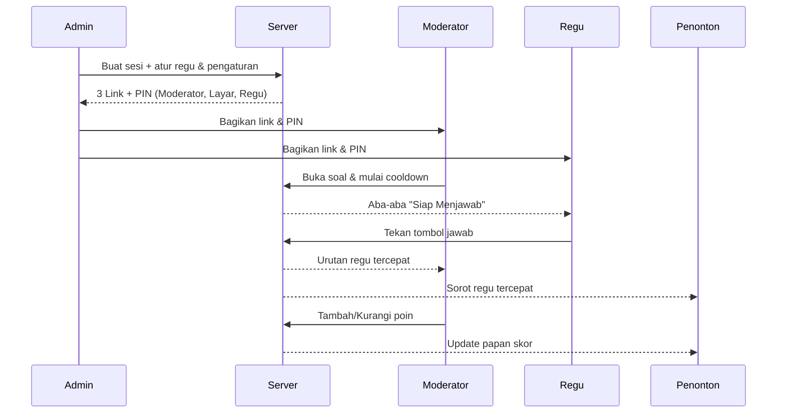
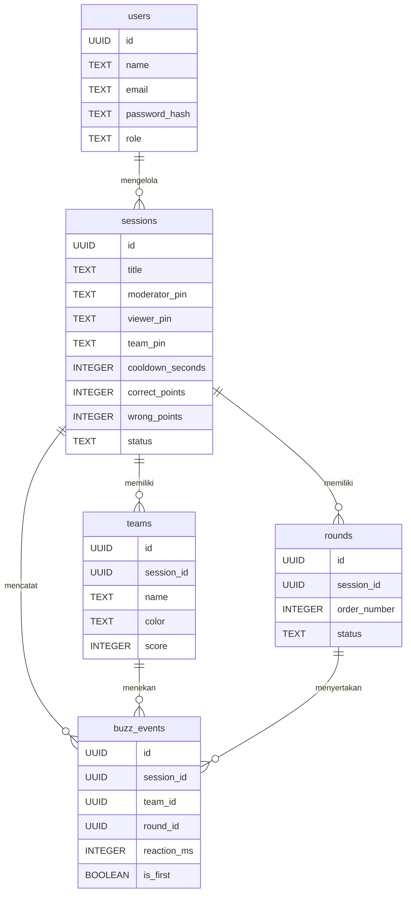

# PRD — Project Requirements Document

## 1. Overview

**Masalah yang Diselesaikan**

Selama ini lomba cerdas cermat masih dijalankan secara manual. Peserta berebut menjawab dengan mengangkat tangan, sehingga sering terjadi perdebatan soal siapa yang lebih dulu mengangkat tangan. Panitia pun kesulitan mencatat dan menghitung poin secara cepat, sementara penonton tidak bisa melihat skor secara jelas dan menarik.

**Tujuan Utama**

Membangun aplikasi web untuk panitia cerdas cermat yang:
- Memberi tombol jawab di HP tiap regu agar penentuan siapa yang paling cepat jadi **adil, akurat, dan bebas tuduhan**.
- Menyediakan dashboard moderator untuk mengatur jalannya lomba secara langsung.
- Menampilkan skor dan hasil lomba ke layar penonton dengan tampilan **modern, ringan, dan keren (gaya gen z)**.
- Menjaga sistem tetap **cepat dan responsif** supaya tidak ada keterlambatan saat peserta menekan tombol.

**Keunggulan Inti**

> Siapa pun yang menekan tombol lebih dulu langsung terdeteksi oleh sistem — tanpa delay, tanpa ribut saling tuduh.

---

## 2. Requirements

**Kebutuhan Fungsional**
- Admin dapat login, membuat sesi lomba, dan mengatur jumlah serta nama regu (maksimal 10 regu).
- Sistem otomatis menghasilkan **3 link terpisah**: Dashboard Moderator, Layar Penonton, dan Dashboard Regu (HP).
- Setiap dashboard dilindungi **PIN** agar hanya orang yang tepat yang bisa masuk.
- Moderator dapat melihat urutan regu tercepat, menambah/mengurangi poin, serta mengubah & mengulang waktu cooldown.
- Setiap regu punya tombol jawab besar di HP yang langsung mengirim sinyal ke sistem.
- Skor yang diatur moderator langsung tampil di layar penonton.
- Admin dapat menyimpan pengaturan lomba (waktu cooldown & nilai poin) untuk dipakai ulang.

**Kebutuhan Non-Fungsional**
- **Kecepatan:** Deteksi klik pertama harus presisi dan nyaris tanpa jeda (real-time).
- **Responsif:** Tampilan nyaman di semua ukuran layar — dari HP regu hingga proyektor besar.
- **Desain Ringan:** Gaya modern, clean, energik, dan gen z.
- **Skalabilitas:** Mampu menangani hingga 10 regu dalam satu sesi secara bersamaan.
- **Keandalan:** Tidak boleh ada jawaban dobel setelah tombol dikunci otomatis.

---

## 3. Core Features

### Fase 1
- **Tombol Jawab Regu** — Regu menekan tombol di HP masing-masing dan sistem langsung tahu siapa yang paling cepat.
  - Tombol Jawab Besar
  - Deteksi Klik Pertama
  - Status Terkunci Otomatis
  - Layar Siap Menunggu
- **Dashboard Moderator** — Pusat kendali moderator untuk memimpin jalannya lomba secara langsung.
  - Mulai & Ulang Soal
  - Urutan Jawab Tercepat
  - Tambah & Kurangi Poin
  - Ubah & Ulang Cooldown

### Fase 2
- **Layar Penonton** — Tampilan besar untuk penonton yang menampilkan skor dan hasil secara jelas.
  - Papan Skor Besar
  - Sorotan Regu Tercepat
  - Desain Ringan & Modern
- **Kelola Regu** — Admin mengatur jumlah dan nama regu peserta sebelum lomba dimulai.
  - Atur Jumlah Regu
  - Beri Nama Regu
  - Warna & Identitas Regu

### Fase 3
- **Sesi & Link** — Admin membuat sesi lomba dan langsung mendapat link untuk tiap peran.
  - Buat Sesi Baru
  - 3 Link Otomatis
  - PIN Peran
  - Bagikan Link
- **Pengaturan Lomba** — Admin mengatur aturan dasar seperti waktu menjawab dan nilai poin.
  - Set Waktu Cooldown
  - Atur Nilai Poin
  - Simpan Pengaturan

### Fase 4
- **Login Admin** — Panitia masuk dengan akun untuk mengatur seluruh jalannya acara.
  - Masuk Admin
  - Kelola Akun Panitia
  - Keluar Aman

---

## 4. User Flow

**Alur Panitia / Admin**
1. Admin login ke aplikasi.
2. Admin membuat sesi lomba baru.
3. Admin mengatur jumlah regu (maks. 10), nama, dan warna tiap regu.
4. Admin mengatur waktu cooldown dan nilai poin.
5. Sistem otomatis menghasilkan **3 link**: untuk moderator, layar penonton, dan HP regu.
6. Admin membagikan link dan PIN ke moderator serta regu.
7. Admin bisa keluar dengan aman setelah acara selesai.

**Alur Moderator**
1. Moderator membuka link dengan PIN yang diberikan admin.
2. Moderator memulai soal dan membuka waktu menjawab (cooldown).
3. Moderator melihat urutan regu yang menekan tombol paling dulu.
4. Moderator menambah atau mengurangi poin sesuai jawaban.
5. Moderator bisa mengubah atau mengulang cooldown kapan saja.
6. Poin langsung tampil ke layar penonton.

**Alur Regu**
1. Regu membuka link di HP dan memasukkan PIN.
2. HP menampilkan layar "siap menunggu" dengan tombol jawab besar.
3. Saat moderator membuka soal, regu menekan tombol secepat mungkin.
4. Sistem langsung mengunci tombol setelah ditekan dan menandai regu tercepat.

**Alur Penonton**
1. Layar besar menampilkan papan skor seluruh regu.
2. Regu tercepat langsung disorot.
3. Skor ter-update otomatis setiap moderator mengubah poin.

---

## 5. Architecture

**Gambaran Sistem**

Sistem terdiri dari satu aplikasi web dengan beberapa antarmuka berbeda yang terhubung ke server real-time:
- **Dashboard Admin** — membuat sesi, mengatur regu & pengaturan lomba.
- **Dashboard Moderator** — mengendalikan jalannya lomba.
- **Layar Penonton** — menampilkan skor secara publik.
- **Dashboard Regu** — tombol jawab di HP tiap regu.
- **Server & Database** — memproses event real-time, menyimpan sesi, regu, dan skor.

Komunikasi waktu-nyata (real-time) memastikan sinyal tombol dan update skor tersampaikan nyaris instan.

---

## 6. Database Schema

Berikut tabel utama yang dibutuhkan sistem.

**users** — akun panitia/admin
| Field | Tipe | Kegunaan |
|---|---|---|
| id | UUID / INTEGER | Identitas unik user |
| name | TEXT | Nama panitia |
| email | TEXT | Email login |
| password_hash | TEXT | Kata sandi terenkripsi |
| role | TEXT | Peran (admin/panitia) |
| created_at | TIMESTAMP | Waktu dibuat |

**sessions** — sesi lomba
| Field | Tipe | Kegunaan |
|---|---|---|
| id | UUID | Identitas sesi |
| title | TEXT | Nama acara/cerdas cermat |
| moderator_pin | TEXT | PIN dashboard moderator |
| viewer_pin | TEXT | PIN layar penonton |
| team_pin | TEXT | PIN dashboard regu |
| cooldown_seconds | INTEGER | Waktu menjawab (detik) |
| correct_points | INTEGER | Poin jawaban benar |
| wrong_points | INTEGER | Poin jawaban salah |
| status | TEXT | Status sesi (draft/aktif/selesai) |
| created_at | TIMESTAMP | Waktu dibuat |

**teams** — regu peserta
| Field | Tipe | Kegunaan |
|---|---|---|
| id | UUID | Identitas regu |
| session_id | UUID | Relasi ke sesi |
| name | TEXT | Nama regu |
| color | TEXT | Warna identitas regu |
| score | INTEGER | Skor saat ini |
| created_at | TIMESTAMP | Waktu dibuat |

**questions / rounds** — soal & ronde (opsional, untuk mengelola soal)
| Field | Tipe | Kegunaan |
|---|---|---|
| id | UUID | Identitas soal/ronde |
| session_id | UUID | Relasi ke sesi |
| order_number | INTEGER | Urutan soal |
| status | TEXT | Status (dibuka/ditutup) |
| started_at | TIMESTAMP | Waktu soal dibuka |

**buzz_events** — catatan tombol jawab
| Field | Tipe | Kegunaan |
|---|---|---|
| id | UUID | Identitas event |
| session_id | UUID | Relasi ke sesi |
| team_id | UUID | Regu yang menekan |
| round_id | UUID | Relasi ke soal/ronde |
| reaction_ms | INTEGER | Kecepatan reaksi (milidetik) |
| is_first | BOOLEAN | Penanda regu tercepat |
| created_at | TIMESTAMP | Waktu tekan |

---

## 7. Tech Stack

Karena tech stack belum ditentukan, rekomendasi default yang cepat, ringan, dan cocok untuk kebutuhan real-time:

- **Frontend:** Next.js (React) + Tailwind CSS + shadcn/ui — cepat, modern, dan mudah dibuat responsif.
- **Backend:** Next.js API Routes / Server + **WebSocket** (untuk komunikasi real-time tombol jawab & update skor).
- **Database:** SQLite (via Drizzle ORM) untuk kesederhanaan, bisa dinaikkan ke PostgreSQL bila acara membesar.
- **ORM:** Drizzle ORM — ringan dan type-safe.
- **Autentikasi:** Better Auth — menangani login admin/panitia dengan aman.
- **Deployment:** Vercel (frontend + API) dengan layanan real-time tambahan (mis. Pusher/Ably) bila diperlukan untuk latensi rendah.

**Catatan Performa:** Untuk memastikan "siapa klik duluan" terdeteksi akurat, disarankan memakai koneksi **WebSocket** dan pencatatan waktu di sisi server (server timestamp), bukan hanya di sisi browser, agar adil dan bebas perdebatan.